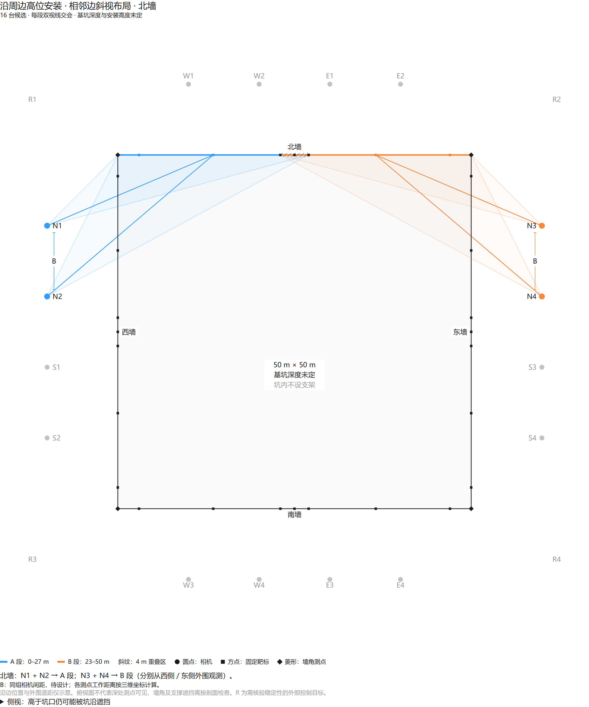

# 古建筑倾侧实时监测与边缘预警装置

本仓库保存图像位移分析代码、实拍研究资料，以及基坑长期视觉监测的方案、设备清单和相机布置图。

## 基坑长期监测方案

整理日期：2026-10-10。已知条件为50 m×50 m正方形基坑、外围安装相机、允许安装墙面靶标，重点监测坑壁位移与法向隆起；视觉系统以独立完成该项全站仪监测作业为目标，精度目标为5 mm以内。

| 文档 | 内容 |
|---|---|
| [长期监测稳定运行规划](docs/基坑长期监测稳定运行规划.md) | 实时采集、运行架构、预警、数据与实施安排 |
| [相机布置与三维隆起测量方案](docs/基坑相机布置与三维隆起测量方案.md) | 同步交会、基线、分段布局、盲区及误差预算 |
| [长期部署与耐候运维细则](docs/基坑相机长期部署与耐候运维细则.md) | 刚性固定、相机自身移动识别、防雨除雾、供电与维护 |
| [实物采购清单](docs/基坑监测实物采购清单.md) | 具体物品、规格、试装及16台备料数量；包含备选一体化适配器MV-ACP-H6P-ADP12V2A/open-ST-4m |
| [现用相机型号与供电核查](docs/现用相机型号与供电核查.md) | 历史型号记录、P7供电接口及资料来源 |
| [相机与MVS使用说明归档](docs/设备资料/MV-CS050-10GM_MVL-MF1618M-5MPE_MVS_使用说明.md) | 相关项目提供的设备操作记录与客户端截图 |
| [既有基坑隆起检测说明](docs/foundation_pit_protrusion_detection.md) | 现有图像分析方法及处理流程 |
| [备选技术路线清单](docs/备选技术路线清单.md) | 历史建筑视频运动放大等备选研究路线 |

坑深、支撑遮挡、可安装点坐标及最差测点精度尚待现场验证。八台为早期构想，当前优先评估相邻边分段十六台方案；图示与数量均不代表已完成现场精度验收。旧方案中的示例配置与最新候选方案一并保留，以最新三维布置方案和采购清单中的说明为准。

## 相机布置图

共三组13张PNG，详见[图片说明](docs/相机布置图/图片说明.txt)：

- [相邻边16台：当前候选](docs/相机布置图/03_相邻边16台_当前候选)：四面墙布置及坑沿遮挡剖面。
- [对岸16台：分段构想](docs/相机布置图/02_对岸16台_分段构想)。
- [对岸8台：早期构想](docs/相机布置图/01_对岸8台_早期构想)。
- [布置图下载包](docs/相机布置图_20261006.zip)。

另保存两份自包含交互HTML：[八台示意](docs/相机布置图/交互图/pit-camera-layout.html)、[分段方案比较](docs/相机布置图/交互图/pit-camera-layout-segmented.html)。下载后用浏览器打开；GitHub文件页仅显示源码。

## 研究报告与实拍资料

- [基坑检测研究报告（Word）](古建筑倾侧实时监测与边缘预警装置_基坑检测研究报告.docx)、[PDF](古建筑倾侧实时监测与边缘预警装置_基坑检测研究报告.pdf)。
- [补充隆起分析网页工作的研究报告（Word）](古建筑倾侧实时监测与边缘预警装置_基坑检测研究报告_补充隆起分析网页工作.docx)。
- [基坑检测研究报告第二版（PDF）](古建筑倾侧实时监测与边缘预警装置_基坑检测研究报告第二版.pdf)。
- [两次实拍综合报告](两次实拍结果综合/墙体荷载响应图像监测项目报告.pdf)。
- [现有算法用于隧道内壁隆起检测的适用性评估（公式修订版）](output/pdf/现有算法用于隧道内壁隆起检测的适用性评估报告_公式修订版.pdf)、[原版](output/pdf/现有算法用于隧道内壁隆起检测的适用性评估报告.pdf)。
- [隆起分析网页使用说明](隆起分析网页/README.md)。

报告与方案记录对应阶段的研究结论；算法运行和页面输出不等同于已经获得现场5 mm三维测量精度。
