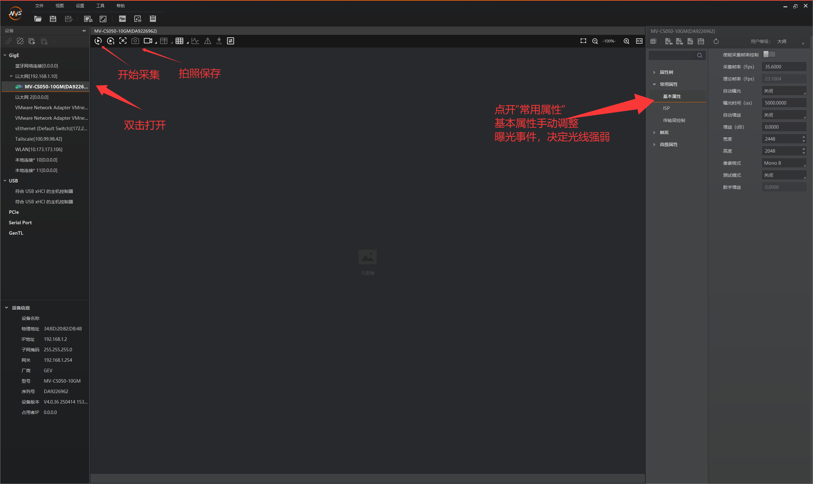
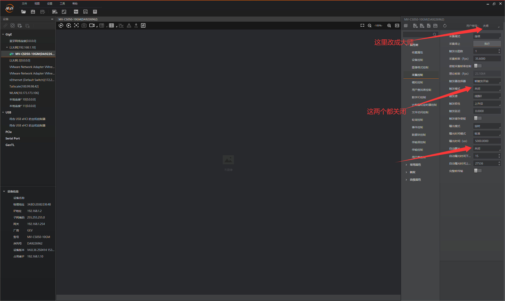

# MV-CS050-10GM 工业相机使用说明

适用组合：`MV-CS050-10GM` 黑白千兆网工业相机、`MVL-MF1618M-5MPE` 镜头、海康机器人 MVS 客户端。

本说明以本机随 MVS 安装的原厂《工业相机客户端 MVS 用户手册 V4.6.1》、MV-CS050-10GM 原厂数据表和随相机提供的 P7 接口速查页为依据。文中标注为“示例”的 IP 地址、曝光值和保存路径不是原厂默认值，应按现场实际修改。

> 安全边界：本型号为 **NPOE** 相机。原厂数据表明确规定供电为 `9–24 VDC`，且**不支持 PoE 供电**。RJ45 插座上的 `LAN/POE` 外观标识不能作为本型号可 PoE 供电的依据。

## 1. 安装前检查

1. 准备相机、镜头、镜头盖、P7 电源/I/O 线、直流电源、网线和电脑。
2. 安装、拆卸镜头和接线时，先断开相机电源。
3. 安装支架应使用原厂外形图标明的安装孔位。图纸标有 M2/M3 安装孔和相应孔深；螺钉的有效旋入长度不得超过图纸规定的螺纹深度。
4. 相机工作环境必须避免冷凝、积水和粉尘直入镜头口。原厂标称为 IP40，不是防水等级。
5. 对隧道监测场景，支架、镜头和线缆固定后不得再调整焦距、焦点、光圈或相机姿态；任何这些变化都会改变成像条件，需重新标定。

## 2. 安装镜头

### 2.1 安装步骤

1. 断开相机电源。
2. 取下相机 C-Mount 防尘盖；避免手指、工具或灰尘接触传感器窗口。
3. 将 `MVL-MF1618M-5MPE` 的 C-Mount 螺纹对正相机镜头接口，轻轻旋入至贴合，不得交叉拧入或过度用力。
4. 将相机固定在支架上，再接通电源并打开 MVS 实时预览。
5. 把目标放在实际工作距离处，本项目当前为约 5 m；调节镜头对焦环至图像边缘最清晰。
6. 以现场亮度调节镜头光圈。锁紧对焦环和光圈环（如镜头结构具备锁紧机构）。

## 3. 供电与 P7 接线

### 3.1 电源要求

相机必须通过 P7 电源/I/O 接口供电：

```text
直流输入：9–24 VDC
典型功耗：2.2 W @ 12 VDC
PoE：本型号不支持
```

建议在接通相机前，用万用表确认电源输出电压和极性。不要把电源线接到 RJ45 网口；不要因 RJ45 口外观标有 `LAN/POE` 而向其注入 PoE。

### 3.2 P7 电源线极性

随相机原厂速查页中，6-pin P7 的相机供电线定义如下：

| P7 针脚 | 线色 | 信号 | 接法 |
| --- | --- | --- | --- |
| Pin 1 | 橙色 | `DC_PWR` | 接直流电源正极 `+V` |
| Pin 6 | 灰色 | `GND` | 接直流电源负极 `0 V/−V` |

> **不要把黑色 `OPTO_GND` 当作相机电源负极。** 黑色线是光耦 I/O 信号地，用于触发/输出接口，不是相机电源回路。

P7 还提供：1 路光耦隔离输入 `Line0`、1 路光耦隔离输出 `Line1`、1 路双向可配置非隔离 I/O `Line2`。若仅做连续取流和单相机标定，不需要连接这些 I/O 线。

### 3.3 上电检查

1. 按上表接好橙色和灰色线。
2. 接通直流电源前，将活动环向后拉；旋转接口尝试插入。找到正确位置后，接口即可顺利插入。
3. 检查相机状态指示灯，蓝色指示灯亮起说明连接成功。

## 4. 连接相机到电脑

### 4.1 物理连接

1. 相机上电后，用千兆以太网线连接相机 RJ45 网口和电脑千兆网口，网线指示灯亮起说明连接成功。
2. 原厂数据表规定，无中继情况下千兆网传输距离最大可达 100 m。
3. 确认电脑“以太网”已建立链路。

### 4.2 在 MVS 中连接相机

1. 启动 MVS，在左侧设备列表展开 `GigE`。
2. 找到相机后，检查状态。
   - **可达/可用**：双击相机连接。
   - **不可达**：右键相机，选择“修改 IP”；按弹窗提示的有效 IP 地址，将相机设置到与 PC 同一网段。
3. 相机连接成功后即可进入实时采集。只有相机显示“不可达”时，才需要按 MVS 的“修改 IP”窗口提示处理。

## 5. MVS 基础使用教学

本节对应本机 MVS 4.6.3 界面；功能名称与原厂 MVS 4.6.1 用户手册一致，但图标位置可能随小版本略有变化。



图 1：MVS 操作界面说明。先在左侧设备列表双击相机打开；图像预览窗口上方可开始采集和保存图片；右侧“常用属性 → 基本属性”用于调节曝光时间和增益。

开始操作前，先在右上角的“用户等级”下拉框中选择 `大师`。然后在右侧属性列表中打开“采集控制”：普通连续采集应将“触发模式”设为 `关闭`；需要手动设置曝光时间时，应将“自动曝光”设为 `关闭`。



图 2：MVS 高级操作界面说明。右上角切换“用户等级”为“大师”后，可在“采集控制”中检查触发模式和自动曝光。

### 5.1 实时预览

1. 在设备列表中选中已连接的相机。
2. 任选下列原厂手册列出的方式开始连续采集，以便查看实时画面、调焦和调整曝光：
   - 右键相机，选择“开始采集”；
   - 按 `F2`；
   - 单击图像预览窗口工具条中的“开始采集”图标。
3. 预览窗口出现实时图像后，底部状态栏的采集帧率应大于 0。
4. 停止采集时，右键选择“停止采集”、再次按 `F2` 或使用预览窗口的停止图标。

连续采集只用于预览和调节画面；正式保存图片时按 5.5 节采用单张抓拍。

### 5.2 触发模式

在右侧属性设置区选择“触发”，将 `触发模式` 设为 `关闭（Off）`。普通实时预览、标定和手工保存图片均使用此设置；关闭后相机由内部机制连续出图。

### 5.3 曝光、增益和像素格式

在右侧“常用属性/基本属性”中设置。

1. **曝光**
   - `自动曝光` 可选“关闭、一次、连续”。
   - 选择“关闭”后才能手动写入`曝光时间`。
   - 原厂数据表给出的本相机曝光范围是 `15 μs–10 s`。
2. **增益**
   - `自动增益` 同样可选“关闭、一次、连续”。
   - 原厂数据表给出的增益范围是 `0–24 dB`。
   - 原厂手册说明：增益升高会使画面变亮，同时增加图像噪声。因此应先通过补光、光圈和曝光时间获得亮度，再视需要少量增加增益。
3. **像素格式**
   - 本型号是黑白相机；用于当前标定和一般预览，选 `Mono 8`。
   - 修改像素格式、分辨率、Binning 或下采样后，应重新确认采集、保存和后续算法输入是否一致。

用于标定或后续双目监测时，在调好画面后固定曝光、增益和光圈，不要保持自动曝光/自动增益连续运行。

### 5.4 设置图像存储路径

1. 在菜单栏选择 `设置 → 录像/抓图`。
2. 打开“路径设置”。
3. 选择需要保存图片的文件夹。
4. 单击“确定”保存设置。

### 5.5 单张抓拍

1. 完成实时预览、对焦和曝光调整后，保持相机画面稳定。
2. 在图像预览窗口上方单击图 1 标注的“拍照保存”图标。
3. 每单击一次保存一张图片；需要下一张时，调整标定板位置或姿态后再次单击该图标。
4. 全部图片保存完成后，停止实时预览。

## 6. 从开机到保存标定照片的最短流程

```text
断电安装镜头
        ↓
P7：橙色接 +V，灰色接 0 V/−V
        ↓
相机 RJ45 接电脑物理千兆网口
        ↓
MVS：GigE 列表中连接相机；不可达则“修改 IP”
        ↓
触发模式 = 关闭（Off）
        ↓
常用属性：调光圈、曝光和增益；调焦后锁定
        ↓
设置 → 录像/抓图：选择保存路径
        ↓
开始采集（F2）→ 单击“拍照保存”保存一张 → 重复单张抓拍 → 停止采集（F2）
```

## 7. 常见问题

| 现象 | 按原厂资料优先检查 |
| --- | --- |
| MVS 搜不到相机 | 相机是否已按 P7 正确供电；RJ45 链路是否已建立；重新打开 MVS 后在 `GigE` 列表中搜索 |
| MVS 显示“不可达” | 右键相机选择“修改 IP”，按窗口提示将相机改到 PC 同一网段 |
| MVS 显示“占用” | 相机已被其他软件或进程连接；关闭占用程序后再连接 |
| 实时画面很暗 | 检查镜头盖、光圈、补光；在“常用属性”中调曝光时间；再根据需要调增益 |
| 增益调高后噪声变大 | 原厂手册说明这是增益放大模拟信号的结果；应优先改善照明/曝光而非持续提高增益 |
| 画面卡顿、丢帧 | 检查网线和电脑网口连接，必要时降低采集帧率 |
| 相机能预览但不能按预期触发 | 检查“触发模式”是否误设为打开；普通连续采集应为关闭（Off） |
